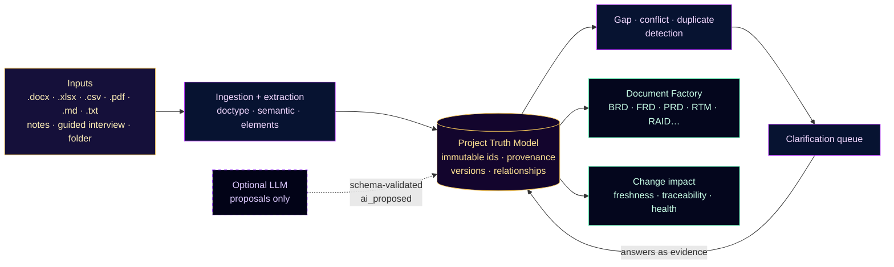

<div align="center">




<p>
  <a href="https://kamikaze1120.github.io/business-doc-analyzer/"></a>
</p>
<p>
  <a href="https://github.com/kamikaze1120/business-doc-analyzer/commits/main"></a>
  
  <a href="LICENSE"></a>
  
</p>

</div>

Drop in a business document — a BRD, PRD, project charter, requirements spec, process doc, or spreadsheet — and it detects the type, extracts requirements, generates test cases, scores quality, and builds a persistent, cross-referencing knowledge base. Underneath sits a **Project Truth Model**: one canonical, provenance-tracked model of the project, from which every document is *generated*. It all runs client-side, in plain HTML and vanilla JavaScript.

<p align="center"><sub><code>BUSINESS ANALYSIS</code> ✦ <code>REQUIREMENTS</code> ✦ <code>TRACEABILITY</code> ✦ <code>LOCAL-FIRST</code> ✦ <code>OPTIONAL AI</code></sub></p>

<h2 align="center">✦ WHAT IT DOES ✦</h2>
<p align="center"><sub>FROM ONE DOCUMENT TO A LIVING PROJECT MODEL</sub></p>

<table>
<tr>
<td width="33%" valign="top">

📄 **Document analysis**<br/>
<sub>Classifies BRD/SRS, PRD, Charter, Agile backlog, process doc or generic, then extracts FR / NFR / integration / business-rule requirements as actor · action · object.</sub>

</td>
<td width="33%" valign="top">

🧪 **Test cases**<br/>
<sub>Generated from each requirement with steps, preconditions, expected results and traceability — exportable to CSV.</sub>

</td>
<td width="33%" valign="top">

🧠 **The Brain**<br/>
<sub>Add documents to a persistent, Obsidian-style graph; shared entities cross-reference across every document. Export / import as JSON.</sub>

</td>
</tr>
<tr>
<td valign="top">

🏛 **Analyst OS**<br/>
<sub>Workspace over the Truth Model: immutable ids, lifecycle, version history, and provenance on every object.</sub>

</td>
<td valign="top">

🔍 **Gaps & conflicts**<br/>
<sub>Rule-registry gap detection, conflict categories with a resolution lifecycle, and layered duplicate detection that never auto-merges.</sub>

</td>
<td valign="top">

❓ **Clarify loop**<br/>
<sub>Impact-ranked question queue; answers write back into the model as provenance-tagged evidence.</sub>

</td>
</tr>
<tr>
<td valign="top">

🏭 **Document Factory**<br/>
<sub>Generate BRD, FRD, PRD, Charter, RTM, Test Plan, RAID Log or Stakeholder Register from the model — each stays linked to its sources.</sub>

</td>
<td valign="top">

🌊 **Change impact**<br/>
<sub>Direct/indirect impact with paths; generated docs flagged <i>Needs Review</i> only when a source version advances. Snapshots, diff, rollback.</sub>

</td>
<td valign="top">

📁 **Guided projects**<br/>
<sub>Section-by-section interview for a BRD, PRD or Charter; resume any time, then generate a full document as <code>.md</code>.</sub>

</td>
</tr>
<tr>
<td valign="top">

📂 **Folder Connect**<br/>
<sub>Pick a local folder once; supported files are ingested into the Brain and Truth Model. Chrome/Edge over https can re-scan later.</sub>

</td>
<td valign="top">

✨ **Mockup generator**<br/>
<sub>With AI on: turns an analyzed BRD into a clickable HTML prototype. The AI returns a typed app-model; a fixed template renders it.</sub>

</td>
<td valign="top">

❤️ **Health dashboard**<br/>
<sub>One explainable readiness score — every deduction itemized — plus objective → requirement → acceptance → test coverage.</sub>

</td>
</tr>
</table>

<h2 align="center">◈ HOW IT FLOWS ◈</h2>
<p align="center"><sub>THE MODEL IS THE SOURCE OF TRUTH · DOCUMENTS ARE GENERATED FROM IT</sub></p>



**Deterministic first.** Everything above works with no AI at all. Every object distinguishes a *Confirmed Fact*, *Stakeholder Statement*, *AI Inference*, *Assumption*, *Open Question* and *Conflict*; AI output is checked against typed schemas ([`js/aischema.js`](js/aischema.js)) before it can create anything, is labelled `ai_proposed`, and is never auto-approved — you **Accept / Edit / Reject**.

<details>
<summary><b>Architecture integrity — the hardening work</b></summary>

<br/>

Evidence and rationale: [`ARCHITECTURE_AUDIT.md`](ARCHITECTURE_AUDIT.md) (audit) and [`IMPLEMENTATION_REPORT.md`](IMPLEMENTATION_REPORT.md) (what was fixed and why).

- **Relationship registry + inverse-aware traversal** ([`relationships.js`](js/relationships.js)) — every edge is validated against allowed source/target types, and analysis can follow a link in either stored direction.
- **Central mutation facade** ([`mutate.js`](js/mutate.js)) — update → version history → change impact → document freshness → health delta → structured result.
- **Versioned export/import** ([`portability.js`](js/portability.js)) — imports are treated as untrusted: schema/type/relationship validation, prototype-pollution guard, backup-before-apply, id-collision handling. Imported content is never executed.
- **Rule registries + scope-awareness** ([`gaps.js`](js/gaps.js)) — mark an aspect out of scope and its gap rules stop penalizing the project.
- **Layered duplicates** ([`duplicates.js`](js/duplicates.js)) — exact / strong / possible layers with a recommended action; merges are explicit and provenance-recorded.
- **Explainable impact & traceability** ([`impact.js`](js/impact.js), [`traceability.js`](js/traceability.js)) — direct vs. indirect impact with the path that caused it; per-hop and full-chain coverage on the dashboard.

The test harnesses described in the implementation report are kept outside this repository — the repo ships the app only.

</details>

<h2 align="center">◆ QUICK START ◆</h2>
<p align="center"><sub>NO INSTALL · NO BUILD · NO SERVER REQUIRED</sub></p>

| | How | Notes |
|---|---|---|
| **A · Open it** | Double-click `index.html` | Works offline from `file://` |
| **B · Use the hosted copy** | [kamikaze1120.github.io/business-doc-analyzer](https://kamikaze1120.github.io/business-doc-analyzer/) | Or host the folder on any static host — a real URL lifts browser limits on storage, Folder Connect re-scan, and in-browser AI |
| **C · Optional Node server** | `node server.js` → `http://localhost:7332` | Standard library only. Serves the app, proxies a local Ollama, and keeps an on-disk brain vault in `brain/` (gitignored) |

```bash
git clone https://github.com/kamikaze1120/business-doc-analyzer.git
cd business-doc-analyzer
# then either open index.html, or:
node server.js        # optional — PORT, OLLAMA_URL, OLLAMA_MODEL env vars are honoured
```

**Supported files:** `.docx` (tables preserved) · `.xlsx` / `.xls` · `.csv` · `.txt` · `.md` · `.pdf` — parsed in the browser by the bundled mammoth, SheetJS and pdf.js in [`lib/`](lib/).

<h2 align="center">✦ AI, IF YOU WANT IT ✦</h2>
<p align="center"><sub>OFF BY DEFAULT · SETTINGS ⚙︎ · KEYS STAY IN YOUR BROWSER</sub></p>

<table>
<tr>
<td width="25%" valign="top">

💻 **On-device**<br/>
<sub>Chrome/Edge built-in model (<code>window.LanguageModel</code>). No key, nothing leaves the machine.</sub>

</td>
<td width="25%" valign="top">

🧩 **In-browser (WebLLM)**<br/>
<sub>Qwen2.5, Llama 3.2 or Phi-3.5 mini via WebGPU. One-time model download, then runs locally.</sub>

</td>
<td width="25%" valign="top">

🔌 **OpenAI-compatible**<br/>
<sub>Presets for Ollama (local), Groq, OpenRouter and Google Gemini — paste your own key — or any custom endpoint.</sub>

</td>
<td width="25%" valign="top">

🅰️ **Anthropic**<br/>
<sub>An approved Anthropic endpoint + key.</sub>

</td>
</tr>
</table>

No API key ships with the app. Ollama can't run *on* a static host like GitHub Pages — use WebLLM there, or point the preset at an Ollama server elsewhere on your network.

<h2 align="center">◈ TECH STACK ◈</h2>
<p align="center"><sub>PLAIN HTML + VANILLA JS · CLASSIC SCRIPT TAGS</sub></p>

<p align="center">
  
</p>

<p align="center"><sub>Parsers: mammoth (.docx) · SheetJS (.xlsx) · pdf.js · Optional: WebLLM (loaded on demand) · Node.js standard library for <code>server.js</code></sub></p>

<details>
<summary><b>Project layout</b></summary>

<br/>

```text
index.html          The app — open this.
server.js           OPTIONAL Node server (std-lib only): app + Ollama proxy + on-disk brain vault
lib/                mammoth.js · xlsx.min.js · pdf.min.js · pdf.worker.min.js
js/
  — Analysis engine —
  semantic.js       Rule-based NLP: decomposes a requirement into parts
  generate.js       Builds test steps from that meaning
  quality.js        Quality scoring + gap findings
  extract.js        Requirements, sections, flow, scenarios, tests
  elements.js       Objectives, scope, stakeholders, milestones, risks…
  doctypes.js       Document-type classifier + per-type views
  — Project Truth Model —
  uid.js            Immutable UUID identity
  storage.js        Storage abstraction (Local / Memory / IndexedDB)
  model.js          Objects, display ids, lifecycle, evidence, versioning
  relationships.js  Relationship registry + inverse-aware traversal
  mutate.js         Central mutation facade
  migrate.js        Non-destructive migration into the model
  ingest.js         Analyzed document → model objects with evidence
  provenance.js     Trust/status/origin badges + evidence panel
  intelligence.js   Requirement quality engine
  gaps.js           Gap rule registry + scope-awareness
  conflicts.js      Conflict detection + resolution lifecycle
  duplicates.js     Layered duplicate detection (explicit merge only)
  questions.js      Impact-prioritized clarification queue
  impact.js         Change impact + document freshness
  traceability.js   Objective → requirement → acceptance → test coverage
  versioning.js     Snapshots, diff, rollback
  portability.js    Versioned, untrusted-safe export/import
  factory.js        Document Factory
  health.js         Explainable readiness score
  aischema.js       Typed AI proposal schemas (validate before mutate)
  agents.js         Specialized BA agents
  workflow.js       Autonomous BA workflow
  osui.js           🏛 Analyst OS workspace
  — Brain, AI, views —
  store.js · brain.js · graph.js · brain_ui.js · knowledge.js · compose.js
  llm.js · ai.js · qa.js · projects.js · folder.js · mockup.js
  render.js · flow.js · app.js
```

</details>

<h2 align="center">◆ PRIVACY ◆</h2>

Documents are parsed in the browser and the brain lives in browser storage — nothing is uploaded. If you turn on a cloud AI endpoint, only the text sent to that AI helper leaves your machine, and only to the endpoint you configured.

<h2 align="center">✦ CONTRIBUTING & LICENSE ✦</h2>

<p align="center">
Issues and PRs welcome — see <a href="CONTRIBUTING.md">CONTRIBUTING.md</a>, the <a href="CODE_OF_CONDUCT.md">Code of Conduct</a>, and <a href="SECURITY.md">SECURITY.md</a> for reporting security concerns.<br/>
Released under the <a href="LICENSE">MIT License</a>.
</p>

<br/>

<div align="center">


<sub><code>◉ BUSINESS-DOC-ANALYZER // GILDED ORBIT</code> · <a href="https://github.com/kamikaze1120">github.com/kamikaze1120</a></sub>

</div>
